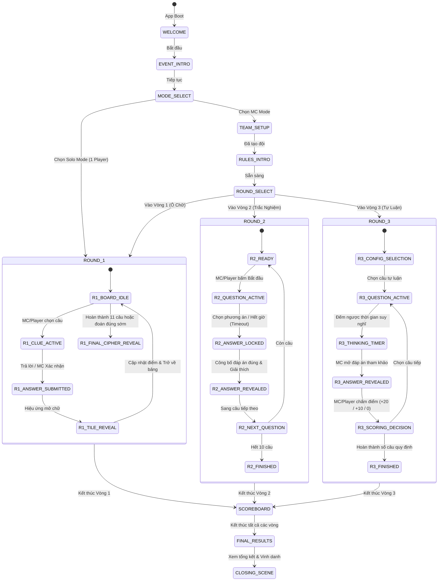

# STATE MACHINE SPECIFICATION
## Mô hình Trạng thái Trò chơi — Marian Light Journey

### 1. Game State Transitions

---

### 2. Định nghĩa Dữ liệu Phiên chơi (Game Session Schema)
- `sessionId`: Chuỗi UUID định danh phiên chơi.
- `version`: Số nguyên biểu thị phiên bản schema (hiện tại `1`).
- `gameMode`: `'MC_MODE' | 'SOLO_MODE'`.
- `currentRound`: `1 | 2 | 3`.
- `currentStage`: Trạng thái con trong vòng (ví dụ `'IDLE' | 'ACTIVE' | 'LOCKED' | 'REVEALED'`).
- `teams`: Danh sách các đội:
  - `id`: string.
  - `name`: string.
  - `color`: string (mã màu đại diện).
  - `score`: number.
  - `roundScores`: `{ round1: number; round2: number; round3: number }`.
- `round1State`:
  - `solvedClues`: Mảng các ID câu hỏi đã giải.
  - `cipherRevealed`: Boolean (đã mở toàn bộ từ khóa hay chưa).
  - `activeClueId`: string | null.
- `round2State`:
  - `currentQuestionIndex`: number.
  - `answers`: Record mapping `questionId` tới `{ selectedOption: 'A'|'B'|'C'|'D'; isCorrect: boolean; teamId?: string; timeRemaining: number }`.
  - `isLocked`: boolean.
- `round3State`:
  - `selectedQuestionIds`: Mảng ID các câu được chọn trong phiên thi.
  - `currentQuestionId`: string | null.
  - `scores`: Record mapping `questionId` tới `{ teamId: string; scoreAwarded: 0 | 10 | 20 }`.
- `history`: Danh sách các biến cố (Actions log) hỗ trợ **Undo** chính xác một hoặc nhiều bước trước đó.
- `updatedAt`: Timestamp ISO 8601.
